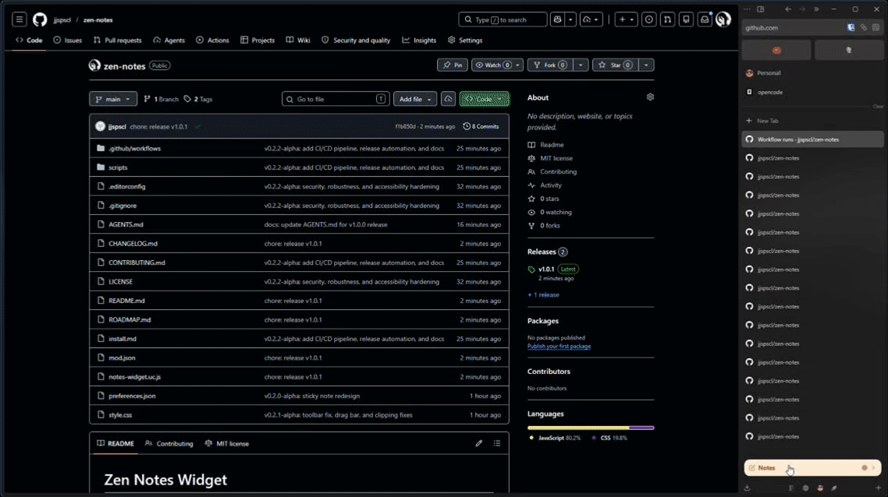

# Zen Notes

A sticky-note style, block-based notes widget for [Zen Browser](https://zen-browser.app/). It sits in the sidebar above the workspace buttons, holds one note, and saves it to your profile. Distributed as a [Sine](https://github.com/CosmoCreeper/Sine) mod.




## Features

- **Sticky-note look** — yellow by default, with light and dark variants that follow the browser; 15 more palettes (Catppuccin, Nord, Gruvbox, Dracula, ...)
- **Block editor** — paragraphs, headings, bullet/numbered/to-do lists (nested), toggles, quotes, callouts, dividers, code
- **Inline formatting** — bold, italic, underline, strikethrough, inline code, links
- **Keyboard first** — `/` block menu, markdown shortcuts (`- `, `1. `, `[] `), Tab indent, Alt+Shift+Up/Down to move blocks
- **Safe storage** — atomic JSON file in your profile, rolling backups, cross-window sync
- **Quiet UI** — toolbar appears only while you edit; empty-note hints disappear when you focus the editor

## Install

Requires Zen Browser 1.7+ and [Sine](https://github.com/CosmoCreeper/Sine).

| Channel | Sine source | Notes |
|---|---|---|
| Stable | `https://github.com/jjspscl/zen-notes` | Releases from `main` |
| Beta | `https://github.com/jjspscl/zen-notes/tree/beta` | Prereleases (`-beta.N`) for testers; replaces stable in the same profile |

In Sine: **Settings → Sine Mods → add a mod from GitHub**, paste the source, restart Zen. Do not copy files into your profile by hand; Sine owns that folder. Details: [install.md](install.md).

## Usage

| Action | Shortcut |
|---|---|
| Bold / italic / underline | `Ctrl+B` / `Ctrl+I` / `Ctrl+U` |
| Strikethrough | `Ctrl+Shift+X` |
| Bullet / numbered / to-do list | `Ctrl+Shift+L` / `Ctrl+Shift+O` / `Ctrl+Shift+C` |
| Link | `Ctrl+K` |
| Indent / outdent | `Tab` / `Shift+Tab` |
| Move block | `Alt+Shift+Up` / `Alt+Shift+Down` |
| Undo / redo | `Ctrl+Z` / `Ctrl+Shift+Z` |
| Change block type | `/` in an empty block |
| Leave the editor | `Esc` |

Click the header to collapse or expand. Drag the top edge to resize. Colour scheme, appearance (system/light/dark), start-collapsed and default height are in the mod's Sine settings.

## Documentation

| For | Read |
|---|---|
| Understanding the code | [docs/architecture.md](docs/architecture.md) |
| Note file format and migration | [docs/storage.md](docs/storage.md) |
| Editor internals | [docs/editor.md](docs/editor.md) |
| Themes and adding a palette | [docs/theming.md](docs/theming.md) |
| Releasing | [docs/release.md](docs/release.md) |
| Why things are the way they are | [docs/decisions/](docs/decisions/) |
| Contributing | [CONTRIBUTING.md](CONTRIBUTING.md) |
| AI coding agents | [AGENTS.md](AGENTS.md), [llms.txt](llms.txt) |
| Changes | [CHANGELOG.md](CHANGELOG.md), [ROADMAP.md](ROADMAP.md) |

## Develop

```bash
npm ci
npm run check   # biome + validators + tests
npm run zen     # live-reloading harness in a disposable Zen profile
```

## Palette attributions

Catppuccin (MIT, © 2021 Catppuccin), Dracula (MIT, Zeno Rocha), Nord (MIT, © 2016-present Sven Greb), Gruvbox (MIT/X11, morhetz), Tokyo Night (Apache-2.0, folke), Rosé Pine (MIT, mvllow), Solarized (MIT, © 2011 Ethan Schoonover), Everforest (MIT, © 2019 sainnhe).

## License

MIT
